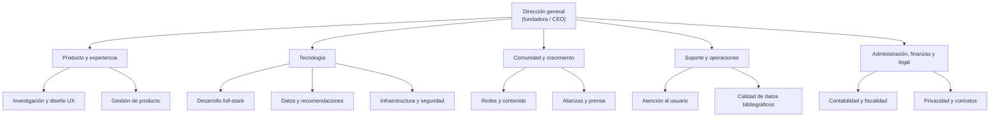
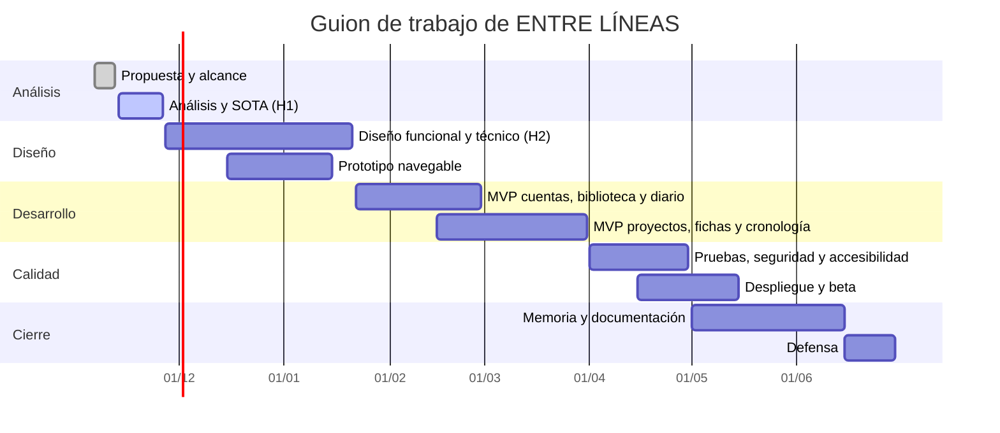

# 01 · Análisis y documentación inicial (RA1)

> **Estado:** versión de trabajo para la entrega **H1 (26-nov-2026)**. Datos y enlaces verificados el **13-nov-2026**. Las cifras de mercado y de usuarios son estimaciones públicas: se indican sus límites en `01b-sota.md`, apartado 8.

## 1. Sector y empresas (CE 1a, 1b)

El sector de **ENTRE LÍNEAS** es el de las tecnologías y servicios digitales para la lectura, la escritura y la publicación. Dentro de él conviven cinco subsectores:

1. **Seguimiento y catalogación de lecturas:** Goodreads, The StoryGraph, Fable, LibraryThing.
2. **Escritura y organización de proyectos literarios:** Scrivener, Campfire, World Anvil, bibisco, Manuskript.
3. **Publicación y comunidades de escritura:** Wattpad, Webnovel, Amazon KDP, Bubok.
4. **Edición tradicional:** Penguin Random House, Planeta, editoriales independientes.
5. **Productividad horizontal usada como sustituto:** Notion, Obsidian, Google Docs, hojas de cálculo y cuadernos.

### 1.1 Clasificación de las empresas

**Por tamaño, estructura organizativa y titularidad**

| Empresa | Sede | Tamaño | Estructura organizativa | Titularidad |
|---|---|---|---|---|
| Amazon (Goodreads, Kindle, KDP) | EE. UU. | Grande | Divisional y matricial: marketplace, dispositivos, AWS, publicidad, contenidos | Sociedad cotizada |
| Naver / WEBTOON Entertainment (Wattpad) | Corea del Sur / EE. UU. | Grande | Divisional: plataformas, contenido, IP, publicidad | Sociedad cotizada; Wattpad es filial |
| Penguin Random House | España / global | Grande | Divisional por mercados y sellos; funciones centrales de edición, ventas y marketing | Privada (Bertelsmann) |
| Planeta | España | Grande | Divisional: editorial, medios, formación, librerías; empresa familiar | Privada y familiar |
| The StoryGraph | Reino Unido | Micro | Funcional, equipo pequeño y remoto; dirección fundadora | Privada |
| Literature & Latte (Scrivener) | Reino Unido | Micro / pequeña | Funcional; producto, desarrollo, soporte y administración | Privada |
| World Anvil | Reino Unido | Pequeña | Funcional con comunidad muy activa; producto, desarrollo, soporte y comunidad | Privada |
| Reedsy | Reino Unido | Pequeña / mediana | Estructura en red: marketplace de profesionales editoriales | Privada |
| Calibre | Comunidad internacional | Comunidad | Proyecto de código abierto; mantenido por voluntarios y donaciones | Comunidad (GPLv3) |
| Notion Labs | EE. UU. | Grande | Funcional por equipos de producto; SaaS horizontal | Privada |

**Por producto o servicio y papel en la cadena de valor**

| Empresa | Producto o servicio | Modelo de ingresos | Papel en la cadena |
|---|---|---|---|
| Amazon | Venta de libros, Kindle, autopublicación (KDP), Goodreads | Comisión, publicidad, suscripción, dispositivos | Infraestructura, distribución y datos |
| Naver / WEBTOON (Wattpad) | Webnovelas, comunidad de lectura y escritura, adaptaciones audiovisuales | Publicidad, monedas, suscripción, licencias de IP | Plataforma y contenido |
| Penguin Random House | Edición y distribución de libros | Venta de libros y derechos | Contenido |
| Planeta | Edición, librerías, medios y formación | Venta de libros, publicidad, formación | Contenido y distribución |
| The StoryGraph | Seguimiento de lecturas, estadísticas, recomendaciones y retos | Freemium (suscripción Plus) | Software |
| Literature & Latte | Scrivener y Scapple | Licencia perpetua | Software |
| World Anvil | Wiki de worldbuilding, cronologías, mapas y manuscrito | Suscripción | Software |
| Reedsy | Marketplace de editores, correctores, diseñadores y maquetadores | Comisión por servicio | Intermediación |
| Calibre | Gestión y conversión de libros electrónicos | Gratuito; donaciones | Software libre |
| Notion | Notas, bases de datos y gestión de proyectos | Freemium y suscripción | Software horizontal sustituto |

**Fuentes:** F1, F3, F4, F6, F7, F8, F9, F10, F11, F12, F13 y F22 (apartado 9).

### 1.2 Empresa tipo: The StoryGraph

Se elige **The StoryGraph** como empresa tipo porque representa el modelo que ENTRE LÍNEAS puede imitar a pequeña escala: una microempresa de software, sin logística ni catálogo propio, que compite con un gigante mediante producto, datos y comunidad.

- **Tamaño:** microempresa. En 2024 su fundadora seguía siendo el equipo de desarrollo principal, con un cofundador y colaboradores externos.
- **Estructura:** funcional, remota y muy plana. Las decisiones de producto y tecnología recaen en la dirección; el resto de funciones se reparte o se externaliza.
- **Datos de crecimiento:** pasó de 3,8 millones de usuarios activos en febrero de 2025 a más de **5 millones de registros** en enero de 2026.
- **Modelo:** freemium sin publicidad. El plan gratuito cubre el seguimiento básico; **Plus** añade estadísticas avanzadas y cuesta 4,99$ al mes o 49,99$ al año.

| Departamento | Funciones principales |
|---|---|
| Dirección general | Estrategia, hoja de ruta, financiación, relación con socios y decisiones finales de producto. |
| Producto y experiencia | Investigación de usuarios, definición de funcionalidades, prototipos, diseño de interfaz y accesibilidad. |
| Tecnología | Desarrollo web y de producto, control de calidad, datos y recomendaciones, infraestructura, seguridad e integraciones. |
| Comunidad y crecimiento | Redes sociales, contenido, prensa, alianzas con booktubers y bookstagrammers, programa de embajadores. |
| Soporte y operaciones | Atención al usuario, moderación, incidencias y revisión de la calidad de los datos de libros. |
| Administración, finanzas y legal | Contabilidad, impuestos, contratos, privacidad, propiedad intelectual y prevención de riesgos. En una microempresa suele estar externalizado. |

**Lectura del sector.** El mercado está polarizado: grandes grupos con economías de escala (Amazon, Naver, PRH, Planeta) y una cola larga de microempresas y proyectos de código abierto. Los grandes monetizan la distribución y los datos; las pequeñas, la especialización y la confianza. La barrera de entrada es baja para publicar una web, pero alta para construir una comunidad y una base de datos bibliográfica fiable. Por eso ENTRE LÍNEAS no debe competir en catálogo ni en red social: debe competir en **flujo de trabajo personal**.

## 2. Necesidades y oportunidades (CE 1c, 1d)

### 2.1 Necesidades priorizadas

Criterio de priorización: se puntúa cada necesidad de 1 a 5 en **frecuencia** (cuántos usuarios la tienen), **intensidad** (cuánto duele), **disposición a pagar** (evidencia de pago o de cambio de herramienta) y **encaje con el TFG** (viabilidad técnica y de plazo). La suma máxima es 20. Se considera **alta** a partir de 16, **media** de 12 a 15 y **baja** por debajo de 12.

| ID | Necesidad | Evidencia | Frec. | Int. | Disp. | Encaje | Total | Prioridad |
|---|---|---|---|---|---|---|---|---|
| N1 | Reunir biblioteca, seguimiento de lecturas y diario en un solo lugar | 66,2 % de la población española lee por ocio; Goodreads ~150 M de miembros; StoryGraph >5 M de registros | 5 | 5 | 3 | 5 | 18 | Alta |
| N2 | Organizar un proyecto literario: capítulos, personajes, escenarios y cronología | Scrivener, Campfire y World Anvil existen y cobran por ello; 32 % elegiría la autopublicación | 4 | 5 | 4 | 5 | 18 | Alta |
| N3 | Una interfaz moderna, clara y sin fricción | El crecimiento de StoryGraph se explica en parte por el descontento con Goodreads; 25.000 altas en un día tras una oleada de migración | 5 | 4 | 3 | 5 | 17 | Alta |
| N4 | Herramientas en español y adaptadas al contexto editorial español | 33,2 % de la población lee en digital; la mayoría de las suites están diseñadas desde el inglés | 4 | 3 | 3 | 5 | 15 | Media-alta |
| N5 | Privacidad y no dependencia de Amazon | La promesa "Amazon-free" de StoryGraph impulsó migraciones masivas | 4 | 4 | 2 | 4 | 14 | Media |
| N6 | Conectar lo que leo con lo que escribo: citas y notas que alimentan el proyecto | No hay evidencia directa de mercado; es la hipótesis diferencial del TFG | 3 | 4 | 3 | 4 | 14 | Media |
| N7 | Exportar y poseer mis datos | Scrivener y bibisco almacenan en local; los usuarios valoran la portabilidad | 3 | 4 | 3 | 4 | 14 | Media |
| N8 | Estadísticas, retos y hábitos de lectura | Goodreads Reading Challenge y las estadísticas de StoryGraph son funciones muy usadas | 4 | 3 | 3 | 4 | 14 | Media |
| N9 | Colaboración con beta readers o coautores | Campfire permite colaboradores; Fable crea clubes de lectura | 3 | 3 | 3 | 3 | 12 | Media-baja |

**Orden de prioridad:** N1 → N2 → N3 → N4 → N5 → N6 → N7 → N8 → N9. N6 no entra en el MVP, pero se mantiene en la hoja de ruta porque es el principal diferenciador frente a Goodreads, StoryGraph, Scrivener y Campfire.

### 2.2 Oportunidad de negocio

Datos cuantitativos que sostienen la oportunidad:

- **Lectura en España:** el 69,8 % de la población de 14 años o más lee libros; el 66,2 % lo hace por ocio; el 33,2 % lee en soporte digital y el 9 % usa audiolibros. El 54,1 % compró algún libro no de texto en el último año (F1, F2).
- **Demanda de herramientas digitales:** Goodreads supera los **150 millones de miembros**; StoryGraph pasó de 3,8 millones de usuarios activos (febrero de 2025) a más de **5 millones de registros** (enero de 2026); Wattpad forma parte de un ecosistema con unos **155 millones de usuarios activos mensuales** (F3, F4, F5, F6, F7).
- **Escritura y autopublicación:** el 32 % de los encuestados elegiría la autopublicación para compartir sus historias, y el Premio Kindle Storyteller recibió cerca de **7.000 obras** en 2025 (F17).
- **Edición independiente:** las editoriales independientes publicaron el **39 % de los títulos de ficción** registrados en España en 2025; la autopublicación representó el 15 %, tras bajar desde el 30 % de 2021 (F16).
- **Mercado de software de escritura creativa:** los informes comerciales lo sitúan entre **754 y 1.150 millones de dólares** en 2025, con un crecimiento anual estimado del **9,5-10,5 %** hasta 2034. Son cifras no auditadas y con metodologías distintas; se usan como orden de magnitud, no como dato exacto (F14, F15).

**Valoración.** No es un mercado masivo como el de las redes sociales, pero sí un nicho con demanda demostrada y dispuesto a pagar por herramientas especializadas. La oportunidad de ENTRE LÍNEAS no está en ganar a Goodreads, sino en ocupar un hueco que hoy obliga al usuario a saltar entre una app de lectura, un procesador de texto, una wiki y una hoja de cálculo. El riesgo principal es el alcance: querer cubrir demasiado y no terminar ninguna de las dos mitades.

## 3. Tipo de proyecto elegido (CE 1e)

Se elige una **aplicación web full-stack de uso personal**, con dos espacios conectados (lector y escritor) y un perfil combinado. El producto se ejecuta en el navegador y se adapta a distintos tamaños de pantalla; no se desarrolla una aplicación móvil ni de escritorio. Tampoco es una red social ni un marketplace.

| Alternativa | Por qué no se elige |
|---|---|
| Red social literaria | Exige masa crítica, moderación, reputación y costes de comunidad. Goodreads y Wattpad ya dominan ese espacio. |
| Marketplace editorial | Requiere pagos, contratos, resolución de disputas y captación de profesionales. Demasiado para un TFG individual. |
| Extensión o plugin de una herramienta existente | Depende de las APIs y de las decisiones de un tercero, no cubre las dos mitades del problema y limita el módulo de despliegue. |
| Software de escritorio | No permite acceso multidispositivo ni despliegue web, y complica la evaluación del módulo de despliegue. |
| Proyecto de datos o analítica | Aporta menos valor directo al usuario y no encaja con el objetivo de producto. |

**Alcance del MVP (antes del 31-mar-2027):**

- **Sí:** RF-01 a RF-09, RF-11 y RF-13. Es decir, cuentas, biblioteca, seguimiento, diario, proyectos, capítulos, personajes, escenarios, cronología, búsqueda y estadísticas.
- **No (v1.1):** RF-10 (vínculo entre citas y proyectos) y RF-12 (exportación). Se documentan como evolución porque N6 y N7 son importantes, pero no imprescindibles para una primera versión funcional.
- **Fuera de alcance:** red social, publicación o venta de obras, aplicación móvil o de escritorio, IA generativa, corrección gramatical avanzada y colaboración en tiempo real.

## 4. Requisitos y restricciones (CE 1f)

Los requisitos parten de las necesidades del apartado 2 y del estudio de `01b-sota.md`. Cada uno tiene una medida o una prueba. La columna **MVP** indica si entra en la primera versión.

### 4.1 Requisitos funcionales

| ID | Requisito | Tipo | MVP | Cómo se verifica |
|---|---|---|---|---|
| RF-01 | Registro con correo verificado, inicio y cierre de sesión y recuperación de contraseña | Funcional | Sí | P-01: pruebas de integración y de aceptación; no se accede sin sesión |
| RF-02 | Perfil editable (nombre, biografía, avatar) y elección de rol lector, escritor o ambos | Funcional | Sí | P-02: prueba E2E; el perfil persiste tras cerrar sesión |
| RF-03 | Biblioteca personal con alta, edición y baja de libros; estados por leer, leyendo, leído y abandonado; búsqueda y filtros | Funcional | Sí | P-03: CRUD completo y búsqueda por ISBN |
| RF-04 | Seguimiento de lectura: fechas, progreso, sesiones, valoración y abandono | Funcional | Sí | P-04: registrar tres sesiones y comprobar el total y el porcentaje |
| RF-05 | Diario literario con entradas, citas, etiquetas, emoción y libro asociado | Funcional | Sí | P-05: crear una entrada y recuperarla desde el libro y desde el diario |
| RF-06 | Proyectos literarios con título, género, sinopsis, estado y objetivo de palabras | Funcional | Sí | P-06: CRUD y validación de campos obligatorios |
| RF-07 | Capítulos y escenas ordenables, con editor de texto, recuento de palabras y estado de revisión | Funcional | Sí | P-07: reordenar capítulos y comprobar que el orden persiste |
| RF-08 | Fichas de personajes con rol, descripción, motivaciones y relaciones entre personajes | Funcional | Sí | P-08: crear dos personajes y una relación; consultarla desde ambos |
| RF-09 | Fichas de escenarios y cronología con eventos, fechas y asociación a capítulos | Funcional | Sí | P-09: crear tres eventos y comprobar el orden cronológico |
| RF-10 | Vincular citas o anotaciones de lectura a un proyecto o escena | Funcional | No (v1.1) | P-10: crear un vínculo y verlo desde la cita y desde el proyecto |
| RF-11 | Búsqueda global en biblioteca, diario, proyectos y fichas | Funcional | Sí | P-11: consulta con un conjunto de datos conocido; resultados en menos de 2 s |
| RF-12 | Exportación de biblioteca, diario y proyecto a JSON y Markdown | Funcional | No (v1.1) | P-12: descargar y comparar el número de registros exportados |
| RF-13 | Estadísticas lectoras: libros y páginas al año, géneros, valoración media y racha | Funcional | Sí | P-13: comprobar los cálculos con un conjunto de datos conocido |

### 4.2 Requisitos no funcionales

| ID | Requisito | Tipo | MVP | Cómo se verifica |
|---|---|---|---|---|
| RNF-01 | El percentil 95 de las páginas responde en menos de 2 s y las consultas API en menos de 500 ms con 50 usuarios concurrentes | No funcional | Sí | P-14: k6 o JMeter + Lighthouse CI con puntuación de rendimiento ≥ 90 |
| RNF-02 | Contraseñas con Argon2id o bcrypt (coste ≥ 12), HTTPS obligatorio, cookies HttpOnly/Secure/SameSite y protección CSRF | No funcional | Sí | P-15: OWASP ZAP sin alertas altas y revisión de configuración |
| RNF-03 | Usabilidad: SUS ≥ 70 y al menos el 80 % de las tareas clave completadas sin ayuda | No funcional | Sí | P-16: test con 5-10 usuarios y cuestionario SUS |
| RNF-04 | Accesibilidad WCAG 2.2 AA: navegación por teclado, contraste ≥ 4,5:1 y textos alternativos | No funcional | Sí | P-17: axe DevTools sin errores críticos y revisión manual |
| RNF-05 | Compatibilidad con las dos últimas versiones de Chrome, Firefox y Edge; diseño responsive de 360 a 1440 px | No funcional | Sí | P-18: matriz de navegadores y comprobación con DevTools |
| RNF-06 | Disponibilidad del 99,5 % mensual; RTO de 4 h y RPO de 24 h | No funcional | Sí | P-19: UptimeRobot y simulacro de restauración |
| RNF-07 | Privacidad: minimización de datos, política de privacidad, borrado de cuenta en ≤ 30 días y cifrado en tránsito | No funcional | Sí | P-20: checklist RGPD y prueba de borrado de cuenta |
| RNF-08 | Cobertura de pruebas ≥ 60 % en la capa de servicios; SonarQube sin incidencias bloqueantes | No funcional | Sí | P-21: JaCoCo + SonarQube |
| RNF-09 | Copia de seguridad diaria con retención de 7 días y restauración en menos de 2 h | No funcional | Sí | P-22: restauración mensual documentada |
| RNF-10 | Interfaz en español y textos externalizados para poder añadir otro idioma | No funcional | Sí | P-23: revisión de cadenas y cambio de locale sin tocar código |

### 4.3 Restricciones

| ID | Restricción | Tipo | Cómo se verifica |
|---|---|---|---|
| REST-01 | Plazos: H1 el 26-nov-2026, H2 el 21-ene-2027, MVP el 31-mar-2027 y entrega final orientativa el 15-jun-2027 | Restricción | Seguimiento en GitHub Projects y actas de reunión |
| REST-02 | Presupuesto máximo de 300 € para todo el TFG (dominio, VPS, certificados y APIs) | Restricción | Registro de gastos y facturas |
| REST-03 | Stack: Java 21, Spring Boot 3.x, MySQL 8.x, HTML/CSS/JavaScript y Git/GitHub | Restricción | Revisión del repositorio y del `pom.xml` |
| REST-04 | Cumplimiento de RGPD/LOPDGDD, LSSI-CE y LPI; datos de ejemplo, sin datos personales reales de terceros | Restricción | Checklist legal y revisión del tutor |
| REST-05 | Equipo de una persona (la alumna) con dedicación de 15-20 h semanales y apoyo del tutor | Restricción | Planificación y seguimiento semanal |
| REST-06 | Solo dependencias con licencias compatibles (MIT, Apache 2.0, BSD o GPL con uso permitido) y atribución correcta | Restricción | Inventario de dependencias con el plugin de licencias de Maven |
| REST-07 | Uso de IA permitido como apoyo, declarado y revisado; sin datos personales en herramientas externas | Restricción | Declaración de uso de IA y revisión de contenido |

### 4.4 Matriz de trazabilidad

| Objetivo | Requisito | Caso de uso | Pantalla o endpoint | Prueba o indicador |
|---|---|---|---|---|
| OBJ-01 Gestionar la identidad y el perfil | RF-01 | CU-01 Registro e inicio de sesión | `POST /api/auth/register`, `POST /api/auth/login` | P-01 |
| OBJ-01 Gestionar la identidad y el perfil | RF-02 | CU-02 Editar perfil y rol | `PUT /api/users/me` | P-02 |
| OBJ-02 Gestionar la biblioteca y las lecturas | RF-03 | CU-03 Alta y edición de un libro | `POST /api/books`, `PUT /api/books/{id}` | P-03 |
| OBJ-02 Gestionar la biblioteca y las lecturas | RF-04 | CU-04 Registrar progreso y sesiones | `POST /api/readings/{id}/sessions` | P-04 |
| OBJ-03 Registrar la experiencia lectora | RF-05 | CU-05 Crear una entrada del diario | `POST /api/journal` | P-05 |
| OBJ-04 Organizar proyectos literarios | RF-06 | CU-06 Crear un proyecto | `POST /api/projects` | P-06 |
| OBJ-04 Organizar proyectos literarios | RF-07 | CU-07 Reordenar capítulos | `PATCH /api/projects/{id}/chapters/order` | P-07 |
| OBJ-05 Documentar el universo narrativo | RF-08 | CU-08 Crear un personaje y una relación | `POST /api/projects/{id}/characters` | P-08 |
| OBJ-05 Documentar el universo narrativo | RF-09 | CU-09 Crear un evento de cronología | `POST /api/projects/{id}/timeline` | P-09 |
| OBJ-06 Conectar lectura y escritura | RF-10 | CU-10 Vincular una cita a una escena | `POST /api/links` | P-10 |
| OBJ-07 Encontrar y exportar información | RF-11 | CU-11 Búsqueda global | `GET /api/search?q=` | P-11 |
| OBJ-07 Encontrar y exportar información | RF-12 | CU-12 Exportar datos | `GET /api/export?format=` | P-12 |
| OBJ-08 Ofrecer estadísticas lectoras | RF-13 | CU-13 Consultar estadísticas | `GET /api/stats` | P-13 |
| OBJ-09 Garantizar calidad, seguridad y accesibilidad | RNF-01 | Transversal | Todas las pantallas | P-14 |
| OBJ-09 Garantizar calidad, seguridad y accesibilidad | RNF-02 | Transversal | Autenticación y sesiones | P-15 |
| OBJ-09 Garantizar calidad, seguridad y accesibilidad | RNF-03 | Transversal | Todas las pantallas | P-16 |
| OBJ-09 Garantizar calidad, seguridad y accesibilidad | RNF-04 | Transversal | Todas las pantallas | P-17 |
| OBJ-09 Garantizar calidad, seguridad y accesibilidad | RNF-05 | Transversal | Diseño responsive | P-18 |
| OBJ-09 Garantizar calidad, seguridad y accesibilidad | RNF-06 | Transversal | Infraestructura | P-19 |
| OBJ-09 Garantizar calidad, seguridad y accesibilidad | RNF-07 | Transversal | Datos y cuenta | P-20 |
| OBJ-09 Garantizar calidad, seguridad y accesibilidad | RNF-08 | Transversal | Código y pruebas | P-21 |
| OBJ-09 Garantizar calidad, seguridad y accesibilidad | RNF-09 | Transversal | Infraestructura | P-22 |
| OBJ-09 Garantizar calidad, seguridad y accesibilidad | RNF-10 | Transversal | Interfaz | P-23 |
| OBJ-10 Cumplir plazo, presupuesto y normativa | REST-01 | Transversal | Planificación | Acta de hitos |
| OBJ-10 Cumplir plazo, presupuesto y normativa | REST-02 | Transversal | Presupuesto | Registro de gastos |
| OBJ-10 Cumplir plazo, presupuesto y normativa | REST-03 | Transversal | Repositorio | Revisión de `pom.xml` |
| OBJ-10 Cumplir plazo, presupuesto y normativa | REST-04 | Transversal | Checklist legal | Revisión del tutor |
| OBJ-10 Cumplir plazo, presupuesto y normativa | REST-05 | Transversal | Planificación | Seguimiento semanal |
| OBJ-10 Cumplir plazo, presupuesto y normativa | REST-06 | Transversal | Dependencias | Informe de licencias |
| OBJ-10 Cumplir plazo, presupuesto y normativa | REST-07 | Transversal | Declaración de IA | Revisión |

## 5. Obligaciones fiscales, laborales y de prevención (CE 1g)

**Punto de partida:** ENTRE LÍNEAS se desarrolla como TFG, sin facturación ni explotación comercial. Por tanto, **no hay obligaciones fiscales ni laborales activas** mientras sea un proyecto académico. Ahora bien, si se comercializara como autónomo o sociedad, o si se abriera al público con cuentas de usuario, sí aplicarían las obligaciones de la tabla. Se incluyen para que el análisis sea completo y para que las decisiones de diseño legal no se dejen para el final.

| Ámbito | Norma | Condición de aplicación | Obligación concreta | ¿Aplica ahora? |
|---|---|---|---|---|
| IVA | Ley 37/1992, del IVA | Venta de servicios digitales en España | Alta censal y declaración trimestral; tipo general del 21 % | No |
| IRPF | Ley 35/2006, del IRPF | Actividad económica como autónomo | Alta en RETA, pagos fraccionados (modelo 130) y declaración anual | No |
| Impuesto de sociedades | Ley 27/2014 | Si se constituye una sociedad | Declaración anual y cuenta de resultados | No |
| Alta censal | Real Decreto 1065/2007 | Inicio de actividad | Modelos 036/037 y epígrafe de actividad | No |
| Facturación | Real Decreto 1619/2012; Ley 18/2022; Real Decreto 1007/2023 | Si se emiten facturas | Factura completa, conservación y, en su caso, software de facturación verificado | No |
| Trabajo autónomo | Ley 20/2007; Real Decreto-ley 13/2022 | Si se trabaja por cuenta propia | Alta en RETA y cotización por ingresos reales | No |
| Trabajo por cuenta ajena | Real Decreto Legislativo 2/2015 | Si se contrata personal | Contratos, nóminas, cotización y convenio aplicable | No |
| Prevención de riesgos | Ley 31/1995; Real Decreto 39/1997 | Si hay personas empleadas | Evaluación de riesgos, plan de prevención, formación e información | No, pero se aplican buenas prácticas ergonómicas |
| Protección de datos | RGPD (UE) 2016/679; LOPDGDD (LO 3/2018) | Siempre que haya cuentas y datos personales | Base jurídica, información, derechos, seguridad, registro de actividades y notificación de brechas en 72 h | **Sí** |
| Servicios de la sociedad de la información | Ley 34/2002 (LSSI-CE) | Web pública con servicios | Aviso legal con los datos del artículo 10 e información sobre cookies | **Sí** |
| Cookies | Art. 22.2 LSSI-CE; Guía de cookies de la AEPD | Si se usan cookies no técnicas | Consentimiento previo, rechazar al mismo nivel que aceptar y política de cookies | **Sí, si se añade analítica** |
| Propiedad intelectual | Real Decreto Legislativo 1/1996 (LPI) | Código propio, contenidos y datos de terceros | Licencias de dependencias, atribución y prohibición de copiar obras protegidas | **Sí** |
| Consumo | Real Decreto Legislativo 1/2007 | Si se cobra a consumidores | Condiciones generales, información precontractual y derecho de desistimiento en contenido digital | No, mientras sea gratuito |
| Accesibilidad | Ley 11/2023; Directiva (UE) 2019/882 | Comercio electrónico y determinados servicios | Requisitos de accesibilidad; las microempresas de servicios pueden quedar exentas, pero se adopta WCAG 2.2 AA como buena práctica | No obligatorio ahora; sí recomendable |
| Inteligencia artificial | Reglamento (UE) 2024/1689 (AI Act) | Si se añaden recomendaciones o generación con IA | Transparencia y evaluación según el nivel de riesgo | No, mientras no haya IA |

**Decisiones para el TFG:**

- No se usarán datos personales reales de terceros; los datos de prueba serán ficticios.
- Habrá política de privacidad, aviso legal y política de cookies desde la primera versión pública.
- Solo se instalarán cookies técnicas y de sesión; si se añade analítica, se pedirá consentimiento previo con opción de rechazo equivalente.
- El borrado de cuenta eliminará los datos personales y conservará únicamente registros agregados anónimos, si fueran necesarios.
- Se revisará la licencia de cada dependencia y de la API de metadatos antes de incorporarla.

## 6. Ayudas y subvenciones (CE 1h)

| Ayuda | Organismo | Qué financia | Importe | Requisitos principales | Plazo | Fuente |
|---|---|---|---|---|---|---|
| ENISA Emprendedoras Digitales 2026 | ENISA (Ministerio de Industria y Turismo) | Préstamo participativo para pymes digitales lideradas por mujeres | 25.000-1.500.000 € | Pyme constituida en España, participación relevante de mujeres, modelo innovador, fondos propios ≥ importe del préstamo, cuentas depositadas | Abierto; sin fecha fija de cierre | F19 |
| Kit Digital | Red.es | Bonos para contratar soluciones digitales (web, comercio electrónico, CRM, ciberseguridad, etc.) | Hasta 3.000 € para autónomos y empresas de 0-2 empleados (segmento III); hasta 12.000 € para 10-49 empleados | Autónomo o pyme, test de madurez digital, alta censal y límite de minimis | Convocatorias por orden de solicitud; a 13-nov-2026 hay que comprobar el estado en Red.es | F18 |
| Kit Consulting | Red.es | Asesoramiento experto en transformación digital, datos, IA y ciberseguridad | 12.000-24.000 € | Pymes de 10 a 249 empleados | No aplica a un proyecto individual; convocatoria sujeta a fondos | F18 |
| Línea ICO Empresas y Emprendedores | ICO | Financiación de inversiones y liquidez | Hasta 20 años de plazo, según la línea | Autónomos y empresas; se tramita en una entidad financiera | Abierta | F23 |

**Lectura realista.** Ninguna de estas ayudas está pensada para un TFG sin empresa constituida. ENISA exige personalidad jurídica y fondos propios equivalentes al préstamo; el Kit Digital exige ser autónomo o pyme y contratar a un agente digitalizador. Por tanto, en el TFG se estudian como **vías de continuidad** si el proyecto se convierte en producto, no como financiación del trabajo académico. La opción más coherente a medio plazo sería darse de alta como autónoma y solicitar el Kit Digital para la web y la ciberseguridad; ENISA tendría sentido solo con una sociedad y un plan de negocio sólido.

## 7. Guion de trabajo (CE 1i)

| Fase | Fechas | Entregable | Responsable | Estado |
|---|---|---|---|---|
| 0. Inicio y propuesta | 6-12 nov 2026 | Documento de inicio y propuesta aprobada | Alumna y tutor | Hecho |
| 1. Análisis y SOTA | 13-26 nov 2026 | `01-analisis.md` y `01b-sota.md` (H1) | Alumna | En curso |
| 2. Diseño funcional y técnico | 27 nov 2026-21 ene 2027 | Casos de uso, modelo de datos, prototipo y arquitectura (H2) | Alumna y tutor | Pendiente |
| 3. Desarrollo del MVP | 22 ene-31 mar 2027 | Versión funcional desplegada | Alumna | Pendiente |
| 4. Pruebas, seguridad y accesibilidad | 1-30 abr 2027 | Informe de pruebas, auditoría ZAP y checklist WCAG | Alumna y 5-10 usuarios | Pendiente |
| 5. Despliegue y beta | 15 abr-15 may 2027 | Entorno de producción, backups y beta cerrada | Alumna | Pendiente |
| 6. Memoria y defensa | 1 may-30 jun 2027 | Memoria, manual y presentación | Alumna | Pendiente |

**Hitos:** H1 (26-nov-2026), H2 (21-ene-2027), MVP (31-mar-2027), beta (15-may-2027), entrega final (15-jun-2027, orientativa) y defensa (junio de 2027). Las fechas finales deben confirmarse con el tutor.

**Seguimiento:** tablero de GitHub Projects con columnas *Backlog → En curso → En revisión → Hecho*, issues por requisito y una reunión quincenal con el tutor. Cada entrega se etiqueta con su hito.

| Riesgo | Probabilidad | Impacto | Mitigación |
|---|---|---|---|
| Alcance excesivo | Alta | Alto | MVP cerrado a RF-01 a RF-09, RF-11 y RF-13; RF-10 y RF-12 pasan a v1.1 |
| Curva de aprendizaje de Spring Security | Media | Medio | Prototipo de autenticación en diciembre; documentar la configuración |
| Pérdida de código o datos | Baja | Alto | Git/GitHub, ramas por funcionalidad y copias diarias de la base de datos |
| Falta de usuarios para probar | Media | Medio | Reclutar 5-10 personas en febrero; plan B con pruebas entre compañeros |
| Cambios en APIs de metadatos | Media | Bajo | Caché local y alta manual como respaldo |

## 8. Glosario

| Término | Definición | Sinónimos que NO uso |
|---|---|---|
| Obra | Texto literario con entidad propia, publicado o no. | Libro (para proyectos en curso), trabajo |
| Proyecto literario | Espacio de trabajo que reúne una obra y sus materiales: capítulos, personajes, escenarios y cronología. | Novela, WIP, carpeta |
| Lectura | Registro de una obra leída o en curso, con fechas, progreso y valoración. | Libro leído, registro |
| Biblioteca personal | Conjunto de obras que el usuario ha añadido a su cuenta, con independencia de que las haya leído. | Catálogo, estantería |
| Estantería | Agrupación personalizada de obras dentro de la biblioteca. | Lista, colección |
| Diario literario | Registro cronológico de impresiones, reflexiones, citas y emociones asociadas a una lectura. | Blog, cuaderno |
| Cita | Fragmento textual de una obra, guardado con su referencia. | Frase, extracto |
| Anotación | Comentario propio sobre una obra, una cita o una escena. | Nota, apunte |
| Reseña | Valoración razonada y pública de una obra. | Opinión, review |
| Ficha de personaje | Documento con los datos, motivaciones, relaciones y evolución de un personaje. | Perfil, personaje |
| Escenario | Lugar o espacio narrativo con sus características y su función en la historia. | Setting, localización |
| Cronología | Orden temporal de los eventos de una obra, con fechas o posiciones relativas. | Timeline, línea temporal |
| Estado de lectura | Situación de una obra en la biblioteca: por leer, leyendo, leído o abandonado. | Estado, situación |
| Rol | Modo de uso de la cuenta: lector, escritor o ambos. | Perfil, tipo de usuario |
| MVP | Versión mínima funcional que se entrega antes del 31-mar-2027. | Prototipo, beta |

## 9. Fuentes consultadas

| ID | Fuente | Enlace | Fecha de acceso |
|---|---|---|---|
| F1 | FGEE, *Hábitos de Lectura y Compra de Libros en España 2025* (informe) | https://federacioneditores.org/wp-content/uploads/2026/02/habitos-de-lectura-2025.pdf | 2026-11-13 |
| F2 | Ministerio de Cultura, nota sobre el Barómetro 2025 | https://www.cultura.gob.es/ca/actualidad/2026/01/260122-barometro-lectura-2025.html | 2026-11-13 |
| F3 | The Guardian, perfil de The StoryGraph y Nadia Odunayo | https://www.theguardian.com/books/2025/feb/16/goodreads-amazon-nadia-odunayo-the-storygraph | 2026-11-13 |
| F4 | The StoryGraph, página oficial de Plus | https://app.thestorygraph.com/plus | 2026-11-13 |
| F5 | Wikipedia, *The StoryGraph* (cifra de 5 M de registros, enero de 2026) | https://en.wikipedia.org/wiki/The_StoryGraph | 2026-11-13 |
| F6 | PPC Land, Goodreads supera los 150 M de miembros (documentación de Amazon) | https://ppc.land/goodreads-joins-amazon-dsp-as-new-supply-source-for-advertisers/ | 2026-11-13 |
| F7 | Business Wire, nota de Wattpad sobre los Watty Awards 2025 | https://www.businesswire.com/news/home/20251203463746/en/Wattpad-Unveils-Winners-Of-The-2025-Watty-Awards | 2026-11-13 |
| F8 | Literature & Latte, tienda de Scrivener | https://www.literatureandlatte.com/store/scrivener | 2026-11-13 |
| F9 | Campfire, precios | https://www.campfirewriting.com/pricing | 2026-11-13 |
| F10 | World Anvil, precios | https://www.worldanvil.com/pricing | 2026-11-13 |
| F11 | GitHub, bibisco (GPL-3.0) | https://github.com/andreafeccomandi/bibisco | 2026-11-13 |
| F12 | GitHub, Manuskript (GPL-3.0) | https://github.com/olivierkes/manuskript | 2026-11-13 |
| F13 | Calibre, sitio oficial | https://calibre-ebook.com/ | 2026-11-13 |
| F14 | Dataintelo, *Creative Writing Software Market* | https://dataintelo.com/report/creative-writing-software-market | 2026-11-13 |
| F15 | Growth Market Reports, *Creative Writing Software Market* | https://growthmarketreports.com/report/creative-writing-software-market | 2026-11-13 |
| F16 | Universidad de Granada, informe LETRAL-IA sobre el mapa del libro español | https://canal.ugr.es/noticia/edicion-independiente-lidera-ficcion-espana-informe-ugr/ | 2026-11-13 |
| F17 | About Amazon, estudio Ipsos sobre hábitos de lectura y autopublicación | https://www.aboutamazon.es/noticias/libros-y-autores/amazon-anuncia-los-cinco-finalistas-del-premio-literario-kindle-storyteller-para-autores-independientes | 2026-11-13 |
| F18 | Red.es, programa Kit Digital | https://www.kitdigital.red.es/ | 2026-11-13 |
| F19 | Cámara de Valencia, ficha de ENISA Emprendedoras Digitales 2026 | https://www.camaravalencia.com/wp-content/uploads/2023/05/ENISA_Financiacion_Emprendedoras_Digitales_2026.pdf | 2026-11-13 |
| F20 | AEPD, *Guía sobre el uso de las cookies* | https://www.aepd.es/guias/guia-cookies.pdf | 2026-11-13 |
| F21 | BOE, RGPD, LOPDGDD, LSSI-CE, LPI, Ley 31/1995 y Ley 11/2023 | https://www.boe.es/ | 2026-11-13 |
| F22 | Reedsy, sitio oficial | https://reedsy.com/ | 2026-11-13 |
| F23 | ICO, línea Empresas y Emprendedores | https://www.ico.es/ | 2026-11-13 |

---

