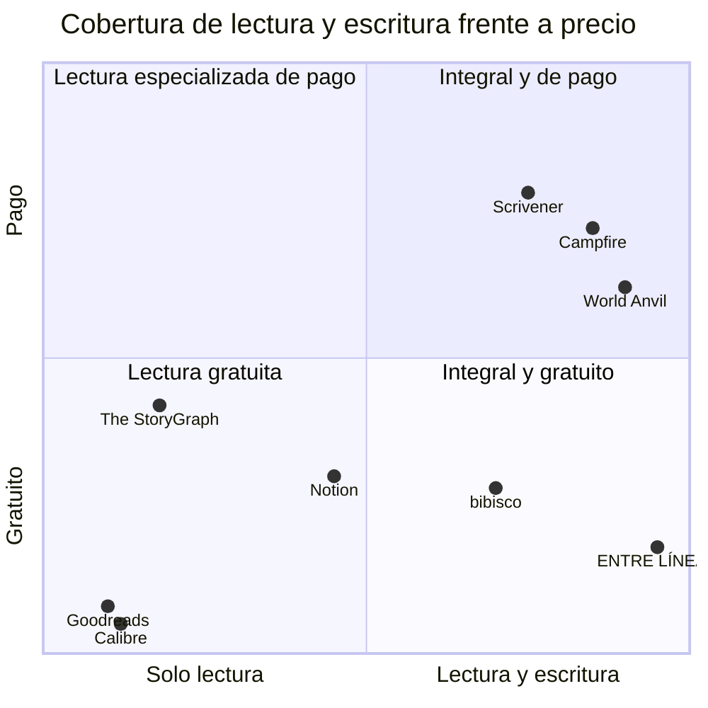

# 01b · Estado del arte (SOTA) de mi proyecto

> **Estado:** versión completa de trabajo para **H1 (26-nov-2026)** y **H2 (21-ene-2027)**. Datos y enlaces verificados el **13-nov-2026**. Los apartados 1, 2 y 5 son los que se entregan en H1; los apartados 3, 4, 6, 7 y 8 se completan en H2, pero se incluyen ya para no dejar el documento a medias. Las cifras de usuarios y de mercado son estimaciones públicas y se discuten en el apartado 8.

## 1. Problema y preguntas de búsqueda (CE 1c)

**Problema:** quien lee y escribe a la vez no tiene un solo lugar donde la biblioteca, el diario de lectura y el proyecto literario estén conectados; hoy salta entre una app de seguimiento, un procesador de texto, una wiki de *worldbuilding* y una hoja de cálculo.

| # | Pregunta | Dónde busqué | Fecha |
|---|---|---|---|
| P1 | ¿Qué soluciones existen para gestionar lecturas, organizar proyectos literarios y conectar ambas actividades, y a quién van dirigidas? | Google y Bing; Google Play y App Store; Product Hunt; GitHub; webs oficiales de cada producto | 2026-11-10 a 2026-11-13 |
| P2 | ¿Cómo ganan dinero esas soluciones: suscripción, *freemium*, licencia perpetua, publicidad, comisión o código abierto? | Páginas de precios y de planes; notas de prensa; repositorios y licencias | 2026-11-10 a 2026-11-13 |
| P3 | ¿Qué parte del flujo «leo → anoto → escribo» cubre cada solución y qué queda fuera? | Documentación de producto, vídeos de demostración, reseñas de usuarios y foros | 2026-11-11 a 2026-11-13 |
| P4 | ¿Qué tecnologías, arquitecturas y modelos de datos usan? | Documentación técnica, repositorios públicos, ofertas de empleo y blogs de ingeniería | 2026-11-12 a 2026-11-13 |
| P5 | ¿Es viable técnicamente una aplicación web full-stack con Java 21, Spring Boot y SQL para un equipo de una persona? | Documentación oficial de Spring, MySQL, Flyway y Docker; encuestas de desarrolladores; pruebas de concepto locales | 2026-11-12 a 2026-11-13 |

**Criterio de búsqueda.** Se priorizaron fuentes primarias (web oficial, página de precios, repositorio y licencia) sobre listados y blogs. Cuando solo se pudo consultar una fuente secundaria, se indica en el apartado 8. No se ha entrevistado a usuarios reales: la evidencia de necesidad procede de informes del sector y de la observación de productos.

## 2. Soluciones existentes (CE 1a, 1c, 2a)

Se comparan ocho soluciones con los mismos criterios: a quién sirven, qué hacen, cuánto cuestan y qué parte del problema cubren. Se incluyen dos proyectos de código abierto y un sustituto no especializado que abarca papel y hoja de cálculo.

| Solución | Para quién | Qué hace | Modelo de precio | Enlace y fecha de acceso | Estado (`leído` / `sin leer`) |
|---|---|---|---|---|---|
| **Goodreads** (Amazon) | Lectores | Catálogo, estanterías, progreso, retos anuales, reseñas y comunidad | Gratuito; publicidad y datos para Amazon; sin plan de pago | https://www.goodreads.com/ (2026-11-13) | `leído` |
| **The StoryGraph** | Lectores que quieren estadísticas y recomendaciones sin Amazon | Seguimiento, estadísticas, retos, recomendaciones por estado de ánimo y contenido; sin publicidad | *Freemium*: gratis + Plus 4,99 $/mes o 49,99 $/año | https://app.thestorygraph.com/plus (2026-11-13) | `leído` |
| **Scrivener** (Literature & Latte) | Escritores de textos largos | Borrador por carpetas y escenas, tablero de corcho, metadatos, exportación y compilación | Licencia perpetua: 59,99 $ escritorio; 49,99 $ educativo; iOS 23,99 $ | https://www.literatureandlatte.com/store/scrivener (2026-11-13) | `leído` |
| **Campfire** | Escritores de ficción y *worldbuilding* | Módulos de personajes, relaciones, cronología, mapas, manuscrito y enciclopedias | *Freemium* modular; se paga por módulos o por plan | https://www.campfirewriting.com/pricing (2026-11-13) | `leído` |
| **World Anvil** | Escritores y creadores de mundos | Wiki de universo, cronologías, mapas, árboles genealógicos, manuscrito y comunidad | Suscripción por niveles; Guild desde unos 4,50 $/mes | https://www.worldanvil.com/pricing (2026-11-13) | `leído` |
| **bibisco** | Escritores de novela | Planificación de novela: capítulos, escenas, personajes, entrevistas y análisis | Código abierto GPL-3.0 (Community) + edición Supporters de pago único (69 $) | https://github.com/andreafeccomandi/bibisco (2026-11-13) | `leído` |
| **Calibre** | Lectores con biblioteca digital | Gestión, conversión, metadatos y préstamo de libros electrónicos | Gratuito, GPLv3; donaciones | https://calibre-ebook.com/ (2026-11-13) | `leído` |
| **Notion, hoja de cálculo y cuaderno** | Cualquier persona | Notas, bases de datos, tablas y papel: sirven para todo y para nada en concreto | Notion *freemium*; hoja de cálculo y papel gratuitos o de bajo coste | https://www.notion.so/ (2026-11-13) | `leído` |

**Lo que cubre cada una.**

- **Goodreads** cubre bien el catálogo y la parte social, pero su interfaz y su dependencia de Amazon generan descontento; no organiza un proyecto de escritura.
- **The StoryGraph** mejora las estadísticas y la recomendación, y es la referencia de producto para una microempresa de software. Tampoco escribe.
- **Scrivener** es el estándar de facto para redactar, pero es de escritorio, no tiene biblioteca de lectura ni diario y su modelo mental es el manuscrito, no la obra viva.
- **Campfire** y **World Anvil** cubren el *worldbuilding* con mucha profundidad, pero están pensados para universos grandes, tienen interfaces densas y no miran hacia la lectura.
- **bibisco** demuestra que un proyecto individual puede construir una herramienta de novela completa y sostenerla con una edición de pago; es la referencia de viabilidad.
- **Calibre** resuelve la biblioteca de archivos, no el seguimiento ni la escritura.
- **Notion, la hoja de cálculo y el cuaderno** son el sustituto real de la mayoría: baratos y flexibles, pero sin modelo de datos literario, sin estadísticas y sin vínculos entre lectura y escritura.

*Figura: cobertura de cada solución según su especialización en lectura o escritura y su precio.*

**Lectura de la figura.** El cuadrante superior derecho (integral y de pago) está ocupado por suites de escritura que no leen. El cuadrante inferior derecho (integral y gratuito) está vacío salvo por soluciones horizontales como Notion, que no entienden de libros. ENTRE LÍNEAS se sitúa a propósito en ese hueco: cubre las dos mitades y renuncia a cobrar en el MVP.

## 3. Modelos de negocio (CE 1d, 1e)

### 3.1 Patrones que se repiten

La tabla incluye dos patrones observados en el sector cuyos productos no están en el apartado 2 —la comisión por intermediación de Reedsy y Fable— porque ayudan a explicar por qué ENTRE LÍNEAS descarta el modelo de marketplace.

| Patrón | Soluciones que lo usan | Ventaja | Riesgo |
|---|---|---|---|
| **_Freemium_ con suscripción** | The StoryGraph, Campfire, World Anvil, Notion | Ingreso recurrente y predecible; el plan gratuito hace de embudo y de red de seguridad | Exige una función de pago realmente valiosa y una base de usuarios grande; la conversión típica es baja |
| **Licencia perpetua** | Scrivener, edición Supporters de bibisco | Ingreso inmediato, sin infraestructura de suscripción y con usuarios que valoran poseer el software | No hay ingresos recurrentes; obliga a vender cada año una versión nueva o a vivir de altas |
| **Código abierto con donaciones o soporte** | Calibre, Manuskript, bibisco Community | Confianza, adopción rápida, coste de marketing bajo y comunidad que contribuye | Monetización débil; el mantenedor asume el coste y el desgaste |
| **Publicidad y explotación de datos** | Goodreads | Gratuito para el lector y alineado con el negocio de Amazon | Privacidad, dependencia del anunciante y conflicto de interés con el usuario |
| **Comisión por intermediación** | Reedsy, Fable | Ingreso alto por operación y sin coste fijo para la plataforma | Requiere masa crítica, pagos, contratos y resolución de conflictos |
| **Gratuito como servicio público o comunitario** | Calibre, bibliotecas digitales | Acceso universal y buena reputación | Depende de financiación externa y de trabajo voluntario |

### 3.2 Business Model Canvas: The StoryGraph

| Bloque | Contenido |
|---|---|
| **Segmentos de clientes** | Lectores intensivos, lectores que abandonan Goodreads, clubes de lectura y creadores de contenido literario. |
| **Propuesta de valor** | Seguimiento de lecturas con estadísticas ricas, recomendaciones por estado de ánimo y contenido, sin publicidad ni dependencia de Amazon. |
| **Canales** | Web, apps móviles, redes sociales, boca a boca y prensa tecnológica y literaria. |
| **Relación con clientes** | Autoservicio, comunidad y atención directa de un equipo pequeño; comunicación pública de la hoja de ruta. |
| **Fuentes de ingresos** | Suscripción Plus (4,99 $/mes o 49,99 $/año). Sin publicidad. |
| **Recursos clave** | Producto, base de datos bibliográfica, algoritmos de recomendación, marca y comunidad. |
| **Actividades clave** | Desarrollo de producto, curación de metadatos, moderación, soporte y comunicación. |
| **Socios clave** | Proveedores de metadatos, tiendas de aplicaciones, prensa y comunidad de lectores. |
| **Estructura de costes** | Desarrollo, infraestructura, soporte, tasas de las tiendas de aplicaciones y administración. |

**Lección para ENTRE LÍNEAS.** StoryGraph demuestra que una microempresa puede competir con un gigante si el producto es mejor en algo concreto y si la comunidad la defiende. También demuestra el peligro contrario: crecer exige mantener una base de datos bibliográfica y una infraestructura que un TFG no puede sostener.

### 3.3 Business Model Canvas: Campfire

| Bloque | Contenido |
|---|---|
| **Segmentos de clientes** | Escritores de ficción y *worldbuilders* con proyectos medianos o grandes; equipos creativos pequeños. |
| **Propuesta de valor** | Un conjunto modular de herramientas para construir un universo coherente y escribirlo en el mismo lugar. |
| **Canales** | Web, YouTube, comunidades de escritura, *booktok* y afiliados. |
| **Relación con clientes** | Autoservicio, tutoriales, comunidad y soporte por correo. |
| **Fuentes de ingresos** | Suscripción y compra de módulos; planes por nivel de uso. |
| **Recursos clave** | Código, diseño de producto, contenido educativo y comunidad. |
| **Actividades clave** | Desarrollo, diseño de módulos, marketing de contenidos y soporte. |
| **Socios clave** | Creadores de contenido, escuelas de escritura y plataformas de pago. |
| **Estructura de costes** | Desarrollo, infraestructura, marketing y soporte. |

**Lección para ENTRE LÍNEAS.** El modelo modular es atractivo, pero multiplica el desarrollo y la facturación. Para un TFG es preferible un producto cohesionado con un solo plan gratuito y, si alguna vez se comercializa, un único plan de pago.

### 3.4 Modelo propuesto para ENTRE LÍNEAS

**Hipótesis, no compromiso.** ENTRE LÍNEAS se desarrolla como TFG de uso personal y no se va a cobrar durante el curso. Si se convirtiera en producto, el modelo más coherente sería un **_freemium_ sin publicidad**:

- **Plan gratuito:** biblioteca, seguimiento, diario, un proyecto literario y estadísticas básicas. Es el plan del MVP y el que se usa en la defensa.
- **Plan de pago (hipótesis):** proyectos ilimitados, estadísticas avanzadas, exportación completa, historial de versiones y sincronización. Precio orientativo de 3,99 €/mes o 29 €/año, por debajo de StoryGraph Plus para competir por precio en el mercado español.
- **Sin publicidad y sin venta de datos.** Es una decisión de producto y también una obligación de confianza: el diario y los borradores son contenido íntimo.
- **Coste real del MVP:** dominio, VPS y copias de seguridad dentro de un presupuesto de 300 €. El modelo de negocio no es la prioridad; la prioridad es que el producto funcione y sea evaluable.

## 4. Herramientas y tecnologías (CE 2a, 2b)

Se comparan las decisiones técnicas con los mismos criterios: madurez, licencia, coste, curva de aprendizaje, encaje con el ciclo formativo y ajuste al problema. La regla de partida es preferir lo visto en el ciclo (Java 21, Spring Boot, SQL) salvo que haya una razón argumentada.

| Decisión | Opción | Madurez | Licencia | Coste | Curva de aprendizaje | Encaje con el ciclo | Elegida |
|---|---|---|---|---|---|---|---|
| **Lenguaje y framework backend** | Java 21 + Spring Boot 3.x | Muy alta | Apache 2.0 / GPL con Classpath Exception | 0 € | Media | Muy alto: es el stack del ciclo | **Sí** |
| | Node.js + Express o NestJS | Alta | MIT | 0 € | Media | Bajo: no se ha trabajado en el ciclo | No |
| | Python + Django o FastAPI | Alta | BSD / MIT | 0 € | Media | Bajo | No |
| | PHP + Laravel | Alta | MIT | 0 € | Media | Bajo | No |
| **Base de datos** | MySQL 8.4 LTS | Muy alta | GPLv2 / licencia comercial | 0 € | Baja | Muy alto: SQL visto en el ciclo | **Sí** |
| | PostgreSQL 16 | Muy alta | Licencia PostgreSQL | 0 € | Media | Medio: SQL, pero no se ha usado | No |
| | MariaDB 11 | Alta | GPLv2 | 0 € | Baja | Alto | No |
| | SQLite | Muy alta | Dominio público | 0 € | Muy baja | Bajo para producción multiusuario | No |
| **Capa de presentación** | Thymeleaf + Bootstrap 5 (SSR) | Alta | Apache 2.0 / MIT | 0 € | Baja | Muy alto: HTML, CSS y JS del ciclo | **Sí** |
| | React o Vue con API REST | Muy alta | MIT | 0 € | Alta | Medio: añade *tooling* y estado | No |
| | JSP + JSTL | Media (legado) | EPL / GPL | 0 € | Media | Alto, pero tecnología en declive | No |
| **Autenticación y sesiones** | Spring Security con sesión y cookies | Muy alta | Apache 2.0 | 0 € | Media | Muy alto: seguridad y sesiones del ciclo | **Sí** |
| | JWT propio | Alta | MIT | 0 € | Alta | Medio: hay que implementar renovación y revocación | No |
| | Auth0 o Keycloak | Muy alta | Comercial / Apache 2.0 | 0-25 $/mes o servidor propio | Media | Bajo: externaliza algo que conviene aprender | No |
| **Migraciones de esquema** | Flyway | Muy alta | Apache 2.0 | 0 € | Baja | Alto: versiona el esquema como el código | **Sí** |
| | Liquibase | Muy alta | Apache 2.0 | 0 € | Media | Medio | No |
| | SQL manual | Alta | — | 0 € | Baja | Bajo: propenso a errores y sin historial | No |
| **Pruebas** | JUnit 5 + Mockito + Testcontainers + Playwright | Muy alta | EPL 2.0 / Apache 2.0 / MIT | 0 € | Media | Alto: pruebas unitarias, de integración y E2E | **Sí** |
| | Selenium | Muy alta | Apache 2.0 | 0 € | Media | Medio: más lento y frágil | No |
| | Solo pruebas manuales | — | — | 0 € | Baja | Bajo: no permite medir cobertura ni regresiones | No |
| **Despliegue** | Docker Compose + Nginx + VPS | Muy alta | Apache 2.0 / BSD | 5-15 €/mes | Media | Muy alto: el módulo de despliegue lo pide | **Sí** |
| | PaaS (Render, Railway, Fly.io) | Alta | Comercial | 0-20 €/mes | Baja | Medio: menos control y coste variable | No |
| | Serverless | Alta | Comercial | Por uso | Alta | Bajo: añade complejidad y *cold starts* | No |
| **Búsqueda** | MySQL FULLTEXT + índices | Alta | GPLv2 | 0 € | Baja | Alto: suficiente para el volumen del MVP | **Sí** |
| | Elasticsearch u OpenSearch | Muy alta | Elastic / Apache 2.0 | 0 € o servicio gestionado | Alta | Bajo: sobredimensionado para un TFG | No |
| **Metadatos de libros** | Open Library API con alta manual de respaldo | Alta | Datos abiertos | 0 € | Baja | Alto: API pública, sin clave y con *fallback* | **Sí** |
| | Google Books API | Alta | Comercial con cuota | 0 € hasta cuota | Baja | Medio: dependencia de una cuota y de sus condiciones | No |
| | Catálogo propio | — | — | Alto | Alta | Bajo: inviable para una persona | No |

**Stack adoptado.**

- **Backend:** Java 21 (LTS), Spring Boot 3.x, Spring Web, Spring Data JPA, Spring Security, Bean Validation.
- **Base de datos:** MySQL 8.4 LTS, con Flyway para migraciones y un índice FULLTEXT para la búsqueda global.
- **Frontend:** Thymeleaf con renderizado en servidor, Bootstrap 5, HTML semántico, CSS propio y JavaScript puntual sin *framework* SPA.
- **Pruebas:** JUnit 5, Mockito, Testcontainers (MySQL real en integración), Playwright para los flujos críticos y JaCoCo para la cobertura.
- **Infraestructura:** Docker Compose (aplicación, base de datos y Nginx), GitHub Actions para integración continua y un VPS con copias de seguridad.
- **Calidad:** SonarQube, OWASP ZAP, axe DevTools y Lighthouse CI.
- **Datos externos:** Open Library para sugerir metadatos por ISBN, siempre con edición manual como respaldo y con caché local.

**Justificación resumida.** El stack no se elige por moda: se elige porque permite entregar el MVP en los plazos, porque es el que se ha trabajado en el ciclo y porque cada pieza tiene una alternativa descartada con un motivo escrito. Las decisiones se registrarán como ADR en `decisiones/` durante H2 (ver apartado 6).

## 5. Hueco y diferenciación (CE 1e)

**Lo que no cubren las soluciones actuales.**

1. **Nadie conecta la lectura con la escritura.** Goodreads y StoryGraph terminan en la estantería; Scrivener y Campfire empiezan en el manuscrito. La cita que emociona al lector no llega nunca al proyecto donde escribe.
2. **El contexto español está poco atendido.** La mayoría de las suites están diseñadas en inglés, con metadatos y flujos pensados para el mercado anglosajón. Una interfaz en español y un modelo de datos que hable de «obra», «lectura» y «proyecto» no es un detalle cosmético.
3. **La privacidad se trata como excepción.** Goodreads vive de los datos y del ecosistema Amazon. ENTRE LÍNEAS puede prometer lo contrario desde el diseño: sin publicidad, sin cesión de datos y con exportación.
4. **Las herramientas son o muy simples o muy densas.** Notion y la hoja de cálculo son flexibles pero no entienden de libros; World Anvil y Campfire son potentes pero abrumadoras para quien empieza una novela.

**Propuesta de valor (3-5 líneas).** ENTRE LÍNEAS es una aplicación web personal para lectores que escriben: reúne la biblioteca, el diario de lectura y el proyecto literario en un mismo espacio, de modo que las citas, las emociones y las reflexiones de un libro puedan convertirse en material del proyecto. No es una red social ni un marketplace, sino un cuaderno de trabajo bien organizado, en español y sin publicidad.

**Honestidad competitiva.** Para llevar solo un registro de lecturas, **The StoryGraph es hoy mejor** que ENTRE LÍNEAS: tiene más datos, más comunidad y años de ventaja. Para redactar una novela, **Scrivener es mejor** que ENTRE LÍNEAS: es maduro, completo y funciona sin conexión. ENTRE LÍNEAS solo gana si el usuario hace las dos cosas y valora tenerlas juntas; por eso el MVP se centra en esa intersección y no intenta igualar a nadie en su terreno.

## 6. Decisiones derivadas (CE 1e, 1f, 2b)

- **Tipo de proyecto elegido** (enlaza con el apartado 3 de [`01-analisis.md`](01-analisis.md)): aplicación web *full-stack* de uso personal, con dos espacios conectados y perfil combinado. Se descartan red social, marketplace, app nativa y software de escritorio por coste, plazo y alcance.
- **Requisitos que salen del estudio** (con su ID del apartado 4 de `01-analisis.md`):
  - RF-03, RF-04 y RF-05: biblioteca, seguimiento y diario, porque son la base que el usuario ya espera de Goodreads y StoryGraph.
  - RF-06 a RF-09: proyectos, capítulos, personajes, escenarios y cronología, porque son la base que el usuario ya espera de Scrivener y Campfire.
  - RF-11 y RF-13: búsqueda global y estadísticas, porque sin ellas el producto pierde la ventaja de tener todo en un sitio.
  - RF-10 y RF-12 pasan a v1.1: el vínculo lectura-escritura y la exportación son el diferenciador y la promesa de privacidad, pero no bloquean una primera versión funcional.
  - RNF-02, RNF-04 y RNF-07: seguridad, accesibilidad y privacidad, derivadas de la comparación con productos que hacen de la confianza su argumento.
- **Decisiones técnicas** (enlace a cada archivo de `decisiones/`): pendientes de crear en H2. Se prevén, como mínimo:
  - `decisiones/0001-stack-java-spring.md`: Java 21 + Spring Boot frente a Node, Python y PHP.
  - `decisiones/0002-base-de-datos-mysql.md`: MySQL 8.4 LTS frente a PostgreSQL, MariaDB y SQLite.
  - `decisiones/0003-renderizado-servidor-thymeleaf.md`: Thymeleaf + Bootstrap frente a SPA con React o Vue.
  - `decisiones/0004-autenticacion-sesiones.md`: Spring Security con sesión frente a JWT y proveedores externos.
  - `decisiones/0005-despliegue-docker-vps.md`: Docker Compose + Nginx + VPS frente a PaaS y serverless.
  - `decisiones/0006-pruebas-y-calidad.md`: JUnit 5, Testcontainers y Playwright frente a Selenium y pruebas manuales.

## 7. Fuentes y calidad (CE 2a)

Se reutilizan los identificadores F1-F23 de [`01-analisis.md`](01-analisis.md), apartado 9, para que ambos documentos sean coherentes. Todas las fuentes se consultaron el **13-nov-2026**.

| # | Fuente (enlace) | Tipo | Fecha de acceso | Fiabilidad (alta / media / baja) y por qué |
|---|---|---|---|---|
| F1 | FGEE, *Hábitos de Lectura y Compra de Libros en España 2025*: https://federacioneditores.org/wp-content/uploads/2026/02/habitos-de-lectura-2025.pdf | Informe sectorial | 2026-11-13 | Alta: informe primario de la patronal, con metodología publicada |
| F2 | Ministerio de Cultura, nota sobre el Barómetro 2025: https://www.cultura.gob.es/ca/actualidad/2026/01/260122-barometro-lectura-2025.html | Nota oficial | 2026-11-13 | Alta: fuente pública; se usa para contrastar F1 |
| F3 | The Guardian, perfil de The StoryGraph: https://www.theguardian.com/books/2025/feb/16/goodreads-amazon-nadia-odunayo-the-storygraph | Medio de comunicación | 2026-11-13 | Media-alta: periodismo contrastado, pero depende de declaraciones de la empresa |
| F4 | The StoryGraph, página oficial de Plus: https://app.thestorygraph.com/plus | Web oficial de producto | 2026-11-13 | Alta para precio y funciones; puede cambiar sin aviso |
| F5 | Wikipedia, *The StoryGraph*: https://en.wikipedia.org/wiki/The_StoryGraph | Enciclopedia colaborativa | 2026-11-13 | Media: útil para localizar datos, verificados contra F3 y F4 |
| F6 | PPC Land, Goodreads supera los 150 M de miembros: https://ppc.land/goodreads-joins-amazon-dsp-as-new-supply-source-for-advertisers/ | Medio especializado | 2026-11-13 | Media: cita documentación de Amazon, pero no es la fuente original |
| F7 | Business Wire, nota de Wattpad sobre los Watty Awards 2025: https://www.businesswire.com/news/home/20251203463746/en/Wattpad-Unveils-Winners-Of-The-2025-Watty-Awards | Nota de prensa | 2026-11-13 | Media: comunicación de la empresa; cifras autodeclaradas |
| F8 | Literature & Latte, tienda de Scrivener: https://www.literatureandlatte.com/store/scrivener | Web oficial de producto | 2026-11-13 | Alta para precio y licencia |
| F9 | Campfire, precios: https://www.campfirewriting.com/pricing | Web oficial de producto | 2026-11-13 | Alta para precio; los planes modulares cambian con frecuencia |
| F10 | World Anvil, precios: https://www.worldanvil.com/pricing | Web oficial de producto | 2026-11-13 | Alta para precio |
| F11 | GitHub, bibisco (GPL-3.0): https://github.com/andreafeccomandi/bibisco | Repositorio | 2026-11-13 | Alta para licencia y código; el precio de Supporters se contrasta en la web del producto |
| F12 | GitHub, Manuskript (GPL-3.0): https://github.com/olivierkes/manuskript | Repositorio | 2026-11-13 | Alta para licencia y actividad del proyecto |
| F13 | Calibre, sitio oficial: https://calibre-ebook.com/ | Web oficial | 2026-11-13 | Alta para licencia y funciones |
| F14 | Dataintelo, *Creative Writing Software Market*: https://dataintelo.com/report/creative-writing-software-market | Informe comercial | 2026-11-13 | Baja-media: metodología opaca y cifras no auditadas; se usa solo como orden de magnitud |
| F15 | Growth Market Reports, *Creative Writing Software Market*: https://growthmarketreports.com/report/creative-writing-software-market | Informe comercial | 2026-11-13 | Baja-media: misma cautela que F14; sirve para triangular |
| F16 | Universidad de Granada, informe LETRAL-IA: https://canal.ugr.es/noticia/edicion-independiente-lidera-ficcion-espana-informe-ugr/ | Nota universitaria | 2026-11-13 | Alta: institución académica; se cita la nota, no el informe completo |
| F17 | About Amazon, estudio Ipsos sobre lectura y autopublicación: https://www.aboutamazon.es/noticias/libros-y-autores/amazon-anuncia-los-cinco-finalistas-del-premio-literario-kindle-storyteller-para-autores-independientes | Nota de empresa | 2026-11-13 | Media: encuesta de Ipsos encargada por Amazon; posible sesgo de interés |
| F18 | Red.es, Kit Digital: https://www.kitdigital.red.es/ | Web oficial | 2026-11-13 | Alta para requisitos; las convocatorias y cuantías deben comprobarse en cada momento |
| F19 | Cámara de Valencia, ficha de ENISA Emprendedoras Digitales 2026: https://www.camaravalencia.com/wp-content/uploads/2023/05/ENISA_Financiacion_Emprendedoras_Digitales_2026.pdf | Documento de intermediario | 2026-11-13 | Media-alta: reproduce bases oficiales; conviene contrastar con ENISA |
| F20 | AEPD, *Guía sobre el uso de las cookies*: https://www.aepd.es/guias/guia-cookies.pdf | Guía oficial | 2026-11-13 | Alta: autoridad de control |
| F21 | BOE, RGPD, LOPDGDD, LSSI-CE, LPI, Ley 31/1995 y Ley 11/2023: https://www.boe.es/ | Legislación | 2026-11-13 | Alta: texto legal consolidado |
| F22 | Reedsy, sitio oficial: https://reedsy.com/ | Web oficial | 2026-11-13 | Alta para el modelo de comisión; no se usa para cifras de mercado |
| F23 | ICO, línea Empresas y Emprendedores: https://www.ico.es/ | Web oficial | 2026-11-13 | Alta para condiciones generales |

**Calidad de la evidencia.** Hay al menos dos fuentes independientes para las cifras de lectura (F1 y F2) y para el modelo de negocio de referencia (F3 y F4). Las cifras de usuarios de plataformas son autodeclaradas o periodísticas, no auditadas: se usan para describir el orden de magnitud, no para calcular cuotas de mercado.

## 8. Límites

- **Cifras de usuarios.** Goodreads (~150 M de miembros), StoryGraph (>5 M de registros) y Wattpad (~155 M en su ecosistema) son datos públicos y en parte autodeclarados. «Miembros» o «registros» no equivale a usuarios activos mensuales, y las fechas de medición no coinciden. No se han podido consultar métricas internas.
- **Informes de mercado.** Las cifras de 754-1.150 M$ y del 9,5-10,5 % de crecimiento anual proceden de informes comerciales con metodologías distintas y no auditadas. Se usan como orientación, no como dato exacto.
- **Precios.** Los precios de StoryGraph, Scrivener, Campfire, World Anvil y bibisco se consultaron el 13-nov-2026 y pueden cambiar. No se ha comprobado el precio final con impuestos ni la disponibilidad en España de todos los planes.
- **Funciones.** La comparación se basa en documentación pública y demostraciones, no en una prueba exhaustiva de cada producto. Puede haber funciones recientes que no se hayan visto.
- **Usuarios.** No se han hecho entrevistas ni encuestas propias; la necesidad se deduce de informes del sector y de la existencia de productos de pago. Es la limitación más importante y se cubrirá con el test de usabilidad de H2.
- **Tecnología.** Las alternativas se han valorado con documentación y experiencia del ciclo, no con un *benchmark* propio. Las pruebas de carga y de seguridad del MVP están pendientes.
- **Legal.** El análisis legal es informativo y no sustituye el asesoramiento de un profesional. Las obligaciones se han identificado por su condición de aplicación, pero no se ha constituido ninguna empresa.
- **Uso de IA.** La búsqueda y la redacción se han apoyado en herramientas de IA, pero cada fuente se ha abierto y comprobado manualmente antes de citarla. La declaración detallada queda pendiente en [`declaracion-uso-ia.md`](declaracion-uso-ia.md).

---

## Criterios de evaluación que alimenta este documento (texto literal)

- **1a)** Se han clasificado las empresas del sector por sus características organizativas y el tipo de producto o servicio que ofrecen.
- **1c)** Se han identificado las necesidades más demandadas a las empresas.
- **1d)** Se han valorado las oportunidades de negocio previsibles en el sector.
- **1e)** Se ha identificado el tipo de proyecto requerido para dar respuesta a las demandas previstas.
- **1f)** Se han determinado las características específicas requeridas al proyecto.
- **2a)** Se ha recopilado información relativa a los aspectos que van a ser tratados en el proyecto.
- **2b)** Se ha realizado el estudio de viabilidad técnica del mismo.

> El SOTA **no añade criterios de evaluación**: reúne en un solo sitio lo que 1a-1f y 2a-2b ya piden. La evaluación sigue las listas de cotejo de H1 y H2.
